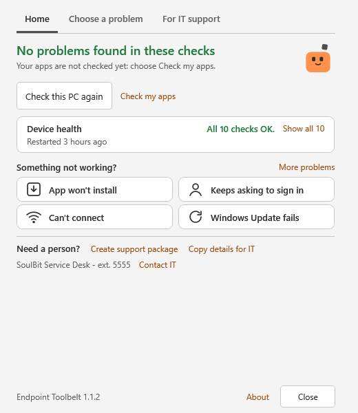

# Endpoint Toolbelt

**Self-service repair for Intune-managed Windows devices.** Endpoint Toolbelt by SoulBit works
with Microsoft Intune; how the name is written is in [docs/naming.md](docs/naming.md).

Endpoint Toolbelt is a Windows desktop app that lets employees and IT support find out why a work
app won't install or why Windows Update keeps failing, fix the common causes themselves, and hand
the rest to IT support with the evidence attached. Standard users run a fixed set of repairs
without administrator rights: a small Windows service does the privileged work and decides what
may run, how often and with which confirmation.



## What it does

- **Checks the device in plain words.** Ten health checks (the link to Intune, the work app
  installer, the work account, Windows Hello, the network to work services, work settings, restart,
  disk space, the clock and Defender) and one verdict on Home.
- **Walks the user through a problem.** "An app from Company Portal won't install", "Teams or
  Office keeps asking me to sign in", "No internet, or work apps can't connect", "Windows Update
  keeps failing", "My device is blocked or 'not compliant'" and more: each path checks first and
  changes nothing until the user chooses a step.
- **Explains every work app.** Per app what the device recorded, how far its last attempt got and
  one next step, with a search over all apps.
- **Repairs what a user may repair.** Retry work apps and settings, clear downloaded app content,
  a full reset of the Intune Management Extension, Windows Update check and repair, recovery key
  backup, clock sync, Defender definitions, disk cleanup, a new IP address, sign-in and Teams
  caches, Office in safe mode and bringing back a window that is off the screen.
- **Hands over to IT support.** "Copy details for IT" gives a ticket text with the evidence; a
  support package collects the logs and the app state in one zip.
- **Stays local and private.** No telemetry and no back end; once a day it reads one small file
  from the publisher's website to see whether a newer version exists (you can switch that off). No
  device or user names in what it copies; it works without a connection for everything that does
  not need one.

## Install

Windows 10 22H2 or Windows 11, x64, enrolled in Microsoft Intune.

```cmd
msiexec /i EndpointToolbelt-<version>-x64.msi /qn SUPPORTURL="https://support.soulbit.example"
```

Deploy it with Intune as a Windows app (Win32), installed as System. The MSI and the files in it
are signed by SoulBit. Download it from [Releases](../../releases), each with its SHA-256.

## Documentation

| For | Guide |
|---|---|
| Employees | [User guide](docs/user-guide.md): using the app, fixing a problem, asking IT for help |
| IT support | [IT support guide](docs/it-support-guide.md): reading a ticket, the checks, every action, the support package |
| Administrators | [Admin guide](docs/admin-guide.md): requirements, deployment, configuration, security products |

Reference:

- [Deployment](docs/deployment.md): what the MSI does, Intune, logs, the Windows Update repair
- [Attack surface reduction rules](docs/asr.md)
- [Security](docs/security.md) and [SECURITY.md](SECURITY.md) to report a vulnerability
- [Architecture](docs/architecture.md) and the
  [trusted service caller contract](docs/trusted-service-caller.md)
- [Building and testing](docs/building.md)
- [Changelog](CHANGELOG.md)

## What it is not

- **No central view.** IT sees only what the user hands over.
- **Not repaired here:** a broken Intune enrollment, an Office repair or the new Outlook's cache.
  The app never restarts the device.
- **Conditional Access:** a local tool cannot tell why a sign-in was blocked; that needs the
  tenant's sign-in logs.
- **English only**, x64 only, and no ADMX template.

## Build

```powershell
.\build\build.ps1    # build, test and package -> artifacts\EndpointToolbelt-<version>-x64.msi
```

Requirements and the test suites: [docs/building.md](docs/building.md).

## License

[MIT](LICENSE) - Copyright (c) 2026 SoulBit.

Endpoint Toolbelt is not affiliated with or endorsed by Microsoft.
Microsoft, Intune and Windows are trademarks of the Microsoft group of companies.
