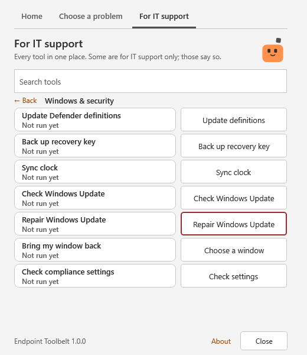
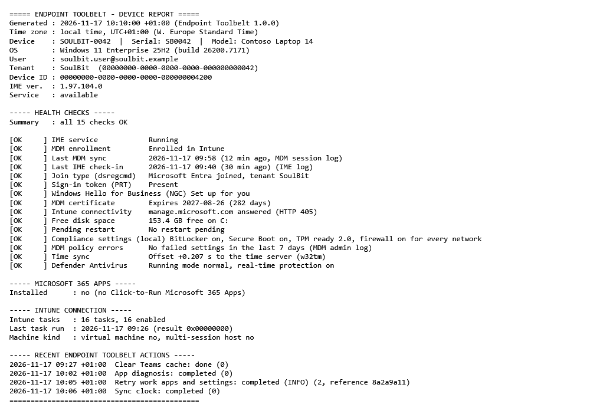
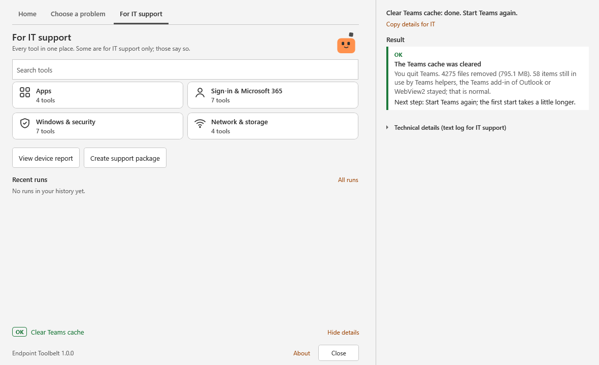

# IT support guide

This guide is for the service desk and second-line engineers who get a ticket from a user who
used Endpoint Toolbelt. It explains what the user can send you, how to read it, what every
check and tool does, and when a problem is beyond the Toolbelt and needs to go further.

- What the user sees and does: [user guide](user-guide.md).
- Installing, configuring and switching tools off: [admin guide](admin-guide.md), with the
  value table in the [admin guide](admin-guide.md#configuration).
- How the parts work together: [architecture](architecture.md); the security model:
  [security](security.md).

Endpoint Toolbelt has no central console. You see only what the user hands over: the text of
**Copy details for IT**, a **support package** in their Downloads folder, or a run log saved
there. Everything below is read on the device, by the user's app and by a Windows service that
runs as SYSTEM.

## What a user can send you

| What | Where the user gets it | What it holds |
|---|---|---|
| Copy details for IT | A link or button on Home, on every problem page, on "My problem is not listed" and in the details drawer of a result | A short ticket text: a reference, the device facts, the evidence, what ran and the next step; for a support package also the zip's name and SHA-256 |
| Support package | "Create support package" on Home, on "My problem is not listed" and on For IT support | `Toolbelt_yyyyMMdd.zip` in Downloads, with logs, app state and an index |
| Run log | Saved by the app after a run that did not end well | `EndpointToolbelt_<Action>_<run ID>.log` in Downloads |
| Device report | For IT support, "View device report" | `HealthReport.txt`: every detailed check with its technical name |



## Read a "Copy details for IT" ticket

Each line is `Label · text`. The device name and the user name never appear: where a line would
contain them, they read `[device]` and `[user]`. No log lines are copied, and a success is
claimed only when the run's end was confirmed.

```text
Endpoint Toolbelt · Sync clock · Reference 3f9c2a71
App version · 1.0.0
Last restart · 2026-11-02 08:12 UTC+01:00 (12 days ago); for IT: the device has not restarted for 12 days
Join type · Microsoft Entra joined
MDM enrollment ID · 11111111-2222-3333-4444-555555555555
Network · connected yes, Wi-Fi, usable address yes
Health · 1 warning: Clock; 9 OK
Evidence · 2026-11-14 10:42 UTC+01:00 · engine summary · OK: The clock is correct
Action · Sync clock, run by the service as SYSTEM
Outcome · The clock is correct.
Next · None needed.
```

This is an example; the texts differ per run and per version.

| Line | What it tells you |
|---|---|
| First line | The product, the run or page it was copied from, and the **Reference**: the run ID. Use it to find the run log and the service and engine log lines. `none` means the text was copied from a page, not from a run. A check that runs inside the app has an ID that starts with `local-`. |
| App version | The Toolbelt version on the device. |
| Last restart | When Windows last started, with its age. A week or longer, or a pending restart, adds a line for IT. The app never restarts the device itself. |
| Join type | Microsoft Entra joined, hybrid joined, registered as a personal device, domain joined only, or not joined. |
| MDM enrollment ID | The EntDMID of the Intune enrollment; only when exactly one enrollment exists. Use it to find the device in Intune. |
| Network | Whether a physical adapter is connected, its kind (Wi-Fi, Ethernet or another adapter) and whether it has a usable address. Never an address, an adapter name or a Wi-Fi name. |
| Health | The ten health checks in one line, with the ones that need attention named. |
| Evidence | When, from which source (the engine's summary, a run still going, a service result without an engine summary, a check in the app) and the top result card. |
| Action | What ran, and as whom: the service as SYSTEM, or the app as the signed-in user. A run that changed nothing ends this line with "; nothing on this device was changed". |
| Tried | On a problem page only: the tools that ran on that page in this app session, with their date and time, outcome and reference, at most six. After a repair the user may have answered "Does it work now?": `Works now: yes`, `not yet` or `not tried`. That answer is the user's, apart from the run's own result. |
| Outcome | The result, or "Still running when this was copied", or "Finished, but the result is not confirmed". |
| Next | The step for the user and the step for IT support. "None needed." only after a confirmed success. |
| Post-check | Only for an app after a step: the original diagnosis, the step and its time, and what a later diagnosis found. See [The post-check](#the-post-check). |

A ticket copied from Home or a problem page has `Reference none` and the action line says the
text was copied from that page and that nothing ran. A ticket from **My problem is not listed**
says that the problem is not one of the listed ones; the user describes it in their own words.

## Read the health checks

The app runs ten checks when it opens and after every tool. Home shows only a count ("All 10
checks OK." or "1 problem, 2 warnings, 7 OK."); **Show all 10** opens the rows as a view of their own (Back returns to Home). On screen a
row with a technical name shows a plain name; Copy details for IT uses the row names below; the
device report lists the detailed checks by their technical names.

| Status | Meaning |
|---|---|
| OK | Nothing to do. |
| Info | OK, and it tells you something, for example that a setting does not apply on this machine. |
| Warning | Needs a look. Shown in the app as WARNING. |
| Problem | Something is wrong. Shown as PROBLEM. |

A row combines several detailed checks, shows the worst of them and names that part ("and 2
more"). Its fix link is the first tool that fixes one of its parts; the link asks the same
confirmation as the tool's own button.

| Row (plain name) | Reads | Thresholds | Fix the user is offered |
|---|---|---|---|
| Intune connection ("Link to your organization") | The enrollment in the registry (the service), the Intune MDM device certificate, the last MDM sync from the MDM event logs (the service, last 30 days) | Enrollment: one is OK, none is a Problem, more than one a Warning. Certificate: under 30 days or expired is a Problem, under 60 days a Warning. Last sync: up to 24 hours OK, up to 7 days Warning, older a Problem | Retry work apps and settings |
| App installer (IME) ("Work app installer") | The IME service state; its last check-in from the IME's own log (the service) | Service not running is a Problem; not installed is a Problem without a fix. Check-in: same ages as the sync. A failed check-in after the last good one (401, 403, a proxy error, no sign-in token) is a Warning, or a Problem when the last good one is older than 7 days. Right after a start the row is OK: "The app installer (IME) started again; first check-in in about N min" (after a device restart: "Starting after the device restarted; first check-in in a few minutes") | Retry work apps and settings |
| Work account | `dsregcmd /status` as the user: join type and sign-in token (PRT) | Entra or hybrid joined without a token is a Warning. Registered or not joined needs no token. Domain joined only or not joined is a Warning | Refresh work account sign-in (for the token) |
| Windows Hello | `dsregcmd` (NgcSet, policy, eligibility, remote session) and the "Use Windows Hello for Business" policy | Set up: OK. Required and not set up: Warning with the PIN step. Required on a device that cannot use it: Warning, contact IT. A virtual machine, a multi-session host, a remote session or not required: Info | None |
| Network to Intune ("Connection to work services") | One TCP and one HTTPS attempt to the device management service, directly or through the user's proxy, and through the machine proxy | Answered: OK. An inspecting proxy, answered for the user only, or not confirmed: Warning. A network sign-in page, a failed secure connection or not reachable: Problem | Check Microsoft connections |
| Configuration profiles ("Work settings") | The MDM admin event log (the service): settings that failed to apply or to be removed in the last 7 days | Any failed setting is a Warning, with the first three named in plain words and when each last failed; a failed removal reads "removing ... failed". The log is not compared with the current assignment: a failure stays listed for 7 days, also after the setting applied or its profile was unassigned, and the hint says so. Never a Problem. Only Windows Hello settings that cannot apply on a virtual machine or multi-session host: Info | Retry work apps and settings (a link; Check this PC again is the main step) |
| Free disk space | The system drive | Under 5 GB a Problem, under 15 GB a Warning | Free up disk space |
| Pending restart ("Restart") | The servicing and Windows Update restart flags, and the Toolbelt's own restart marker | A Warning or OK, never a Problem | None: the user restarts when the organization allows it |
| Clock | The time source and its offset (`w32tm`), the virtual machine time provider | Under 60 seconds OK, under 5 minutes a Warning, 5 minutes or more a Problem. Kept by the virtual machine host: Info | Sync clock (only when the time service is not running or the offset is off) |
| Microsoft Defender | Defender's status through WMI | Passive or EDR block mode: OK. Real-time protection off: a Problem without a fix. Security intelligence older than 7 days: a Problem, older than 3 days: a Warning | Update Defender definitions |

The first three rows offer **Retry work apps and settings**; every other row gives its own step
or none. A row without a fix whose hint names IT support ends with "Contact your IT support."

### The device report

**View device report** runs the checks again and opens `HealthReport.txt`
(`%LOCALAPPDATA%\EndpointToolbelt\`). It is also in every support package. Its parts, in order:

1. The time it was generated, the user's time zone, and the device clock's zone when it differs.
2. The first-line facts: last restart, join type, MDM enrollment ID (EntDMID), network.
3. Device facts: device name, serial number, model, Windows version, the user's UPN, tenant name
   and ID, device ID, IME version, the service's state, the last run.
4. HEALTH CHECKS: a summary ("Problems", "To check"), then every detailed check on one line,
   `[Status] name detail`, with its technical name (MDM enrollment, MDM certificate, Sign-in
   token (PRT), Time sync, Defender Antivirus, ...) and details such as the log the last sync was
   read from.
5. The local compliance settings: BitLocker, Secure Boot, TPM, the firewall per profile and the
   Windows build. These are what Intune compliance usually checks; the report never gives a
   compliance verdict.
6. MICROSOFT 365 APPS: version, platform and update channel.
7. INTUNE CONNECTION (when the service answered): the enrollment's tasks, a disabled Intune
   task by name, and the machine kind.
8. RECENT ENDPOINT TOOLBELT ACTIONS: the last five history lines.



## Repair actions run by the service

These run in the Windows service as SYSTEM. The service enforces the same confirmations the
app asks for, allows one run at a time on the device (a second request gets `Busy`), and limits
each user to 20 device-changing actions per hour (`UserRateLimitPerHour`). A slot is used when
the service accepts the request, also when the run then ends in a cooldown or finds nothing to
do. Every tool except Retry, the support package and the app diagnosis can be switched off by
the organization ([admin guide](admin-guide.md)).



### Summary

| Action | Confirmation | Limit | Counts toward 20 per hour |
|---|---|---|---|
| Retry work apps and settings | None | None | Yes |
| Clear downloaded app content | Yes | None | Yes |
| Full IME reset | Yes, plus other sessions | Cooldown, default 1 hour | Yes |
| Check Windows Update | None | 30 per hour, shared with the app diagnosis | No |
| Repair Windows Update | Yes, plus other sessions | Cooldown, default 4 hours | Yes |
| Back up recovery key | None | None | Yes |
| Sync clock | None | None | Yes |
| Update Defender definitions | None | None | Yes |
| Free up disk space | Yes, plus other sessions | None | Yes |
| Get a new IP address | Yes, plus other sessions | None | Yes |
| App diagnosis | None | 30 per hour, shared with Check Windows Update | No |
| Create support package | None | 4 per hour on a shared device | No |

"Plus other sessions" means: when other users are signed in, the confirmation names how many,
and the action is refused when they cannot be counted or when the organization set
`AllowMachineWideOnMultiSession` to 0. See [Remote sessions and multi-session hosts](#remote-sessions-and-multi-session-hosts).

### Retry work apps and settings

The user's help text: "Asks Intune to check this PC again and retries failed apps. While other
people are signed in to this PC, the apps are retried later by themselves. It affects more than
one app."

- **Changes:** records the current Win32 app state, restarts the IME, clears its app retry
  timers (the `GRS` keys only) and asks Windows for an MDM sync.
- **Never touches:** detection and reporting state; Company Portal stays open.
- **Verified by:** the sync counts only when its session shows in the MDM event log.
- **Results:** exit 0, or 2 when the sync was queued, throttled or could not be verified, or 1
  when the IME is not working or the sync failed. Apps that needed attention before are named once
  (APPS-BEFORE); a download that has not moved for 15 minutes is reported as stuck
  (APP-DOWNLOAD-STUCK).
- **While other users are signed in:** the IME restart and the timer clear are skipped
  (IME-REFRESH-SKIPPED); the result then estimates when the IME retries each failed app by itself
  (24 hours after the failure).
- **Next:** the status says "Retry requested" until the retried apps are detected again. The app
  checks the retried apps once by itself after a successful run.

### Clear downloaded app content

- **Changes:** removes the unpacked app folders under the IME cache (`IMECache`), so the IME
  downloads them again.
- **Never touches:** a folder with a file open in any session, `HealthScripts`, the IME service,
  the Delivery Optimization cache. Links are never followed.
- **Results:** APPCACHE-CLEARED, APPCACHE-EMPTY, APPCACHE-IN-USE (exit 2 when more folders stayed
  in use than were removed), APPCACHE-FAILED.
- **Next:** Retry work apps and settings, so the IME downloads again. Use it for a stuck download
  or a failed hash check.

### Full IME reset

- **Before it runs:** the app asks the user to close Company Portal (it waits up to 20 seconds and
  never closes it by force). If Company Portal stays open in any session, the reset stops before it
  changes anything (FULLRESET-PORTAL-OPEN).
- **Changes,** with the IME stopped: the IME's Win32 app state, the status reports it already sent
  (`StatusServiceReports`), the staging and unpacked app content, its policy cache, and Company
  Portal's local app status cache file in each user profile. Then it starts the IME and asks for a
  verified MDM sync.
- **Never touches:** platform script and remediation state, any other file in a user profile.
- **Results:** FULLRESET-DONE; FULLRESET-PARTIAL (exit 2) when a part could not be cleared, for
  example a profile where FSLogix made the package folder a junction; COOLDOWN (exit 69001).
- **Cooldown:** `FullResetCooldownHours`, default 1. It is set before the wipe and kept even when a
  run is stopped halfway.
- **Next:** the IME processes every assigned app again and reports their state again.
- **The app page after it:** the steps the user took before the reset (Company Portal opened,
  Retry, a handover) end, because their apps' records are gone; until the IME checks in again, the
  page says "The app installer was reset at 14:58. It reads your apps again at its next check-ins,
  usually within an hour. Check again later." instead of counting apps.

### Check Windows Update

- **Reads only:** the last successful quality update and its age, update failures since then in
  plain words, what policies say (an update server, no internet locations, access off, automatic
  updates off, a pause, a deferral and whether Intune or Group Policy sets it), the update
  services' start types, a pending restart and free space.
- **Never:** searches for updates, changes anything or writes a cooldown.
- **Verdicts:** up to date, behind, failing, blocked by policy, services disabled, restart
  pending, low space, no history. A released update that a deferral still holds back is named with
  the day it is offered.
- **Next:** Repair Windows Update is suggested only where it can help: never past a policy, a
  disabled service or a pending restart. For a held-back update, IT can send it sooner (an
  expedited update in Intune).

### Repair Windows Update

- **Before it runs:** with a servicing restart pending, the app asks for the restart and does not
  start the repair (exit 69002 from the service).
- **First** it diagnoses. A current device is left alone (exit 69003, no cooldown).
- **Then** it takes one route that fits what it found:
  - the transaction log or ghost network adapters: at least 50 disconnected virtual adapters of the
    Azure network drivers, with the matching CBS.log failure;
  - component store repair: DISM ScanHealth and RestoreHealth, then SFC;
  - low space: StartComponentCleanup, then search and install;
  - delivery: the download cache, then search and install;
  - behind: search and install.
- **Download cache:** clearing it stops Windows Update, BITS and Delivery Optimization for a
  moment. It also clears the update database (`SoftwareDistribution\DataStore`) on evidence (a
  0x80248xxx code, or a search that still fails after the cache was cleared); that removes the
  update history on the device. Never done on a shared device or while an update installs.
- **Never:** restarts the device, touches catroot2 or Windows Installer. Stale servicing packages
  are removed only when `WURemoveStalePackages` is 1.
- **Duration:** up to about two hours.
- **Cooldown:** `WURepairCooldownHours`, default 4, kept only when the device was changed.
- **Results:** WU-INSTALLED, WU-RESTART-REQUIRED, WU-POLICY-BLOCKS (report only), WU-NO-REPAIR-SOURCE,
  WU-INSTALL-FAILED, WU-CACHE-RESET-SKIPPED and others; each with a step.

### Back up recovery key

- **Changes:** asks BitLocker to back up the existing recovery passwords of the system drive to
  Microsoft Entra ID. Needs an Entra-joined device.
- **Never:** adds, removes or suspends a protector, and never reads the password.
- **Verified by:** BitLocker's own success event in its management log, within about 30 seconds.
- **Results:** BITLOCKER-BACKUP-DONE; BITLOCKER-BACKUP-UNVERIFIED (exit 2); BITLOCKER-OFF,
  BITLOCKER-NO-RECOVERY-PASSWORD or BITLOCKER-NOT-JOINED (exit 2); BITLOCKER-KEY-LIMIT (exit 1).
- **Key limit:** Entra ID holds no more keys for this device. A retry does not help. Remove old
  keys, and find what creates new ones; the result names automatic device encryption of another
  volume (such as a temporary disk after every start) when the events show it.

### Sync clock

- **Changes:** starts the Windows Time service when it is stopped and asks it to resynchronize.
- **Never:** changes the time source or any time setting.
- **Verified by:** the offset to the source is under 60 seconds afterwards.
- **Results:** CLOCK-OK, CLOCK-STILL-OFF, CLOCK-NOT-VERIFIED, CLOCK-SYNC-FAILED,
  CLOCK-SERVICE-NOT-STARTED.
- **Next:** a clock that stays off points to the time source or the network to it.

### Update Defender definitions

- **Changes:** runs Defender's own update tool from its protected folder, after checking its
  Microsoft signature.
- **Never:** changes a Defender setting, an exclusion or its mode. Changes nothing when Defender is
  passive, in EDR block mode or off (exit 69003).
- **Verified by:** a newer security intelligence version or update time.
- **Results:** DEFENDER-UPDATED, DEFENDER-ALREADY-CURRENT, DEFENDER-UPDATE-FAILED,
  DEFENDER-TOOL-UNTRUSTED.

### Free up disk space

- **Changes:** first the app deletes the user's own temporary files that are older than a day
  (as the user, inside the profile, skipping files in use). Then the service clears the Delivery
  Optimization cache with its own cmdlet and runs DISM `/StartComponentCleanup` (never
  `/ResetBase`).
- **Never:** deletes files itself in a folder a standard user can change.
- **Verified by:** at least 1 MB freed. Every result states the free space before and after
  ("was 41.2 GB before and is 44.9 GB now").
- **Results:** DISK-FREED, DISK-CLEANUP-INCOMPLETE, DISK-NOTHING-TO-FREE.

### Get a new IP address

- **Changes:** renews the DHCP lease of the one physical adapter the user chose, through
  Windows' own WMI method; VPN, Bluetooth and other virtual adapters are not offered. The
  connection on that adapter drops for a moment, for everyone on the device.
- **Verified by:** Windows reports a usable IPv4 address (not 169.254.x.x) within 15 seconds.
- **Results:** got a usable address; still no usable address (the DHCP server did not answer);
  without a renew: a fixed address, an adapter that is off, has no driver or no cable or Wi-Fi
  connection, each with its step.
- **Logged:** the adapter's kind and whether it has a usable address; never its name, an address
  or a Wi-Fi network.

## Tools that run as the user

These run in the app with the user's own rights, in the user's own profile. They cannot reach
another user's profile. An organization can hide them, but a user could do the same by hand.

| Tool | Changes | Never | Confirmation | Result |
|---|---|---|---|---|
| Check Microsoft connections | Nothing. Per connection (device management, sign-in, device registration, Delivery Optimization, Outlook on the web) a TCP connection, then one unauthenticated HTTPS request, directly or through the user's proxy and the machine proxy | Sends credentials to the service, follows redirects, logs URLs, headers or bodies | None | "Answered" means a certificate valid for that name and any HTTP answer; for sign-in, the public OpenID document |
| Refresh work account sign-in | Asks Windows to renew the sign-in token (`dsregcmd /refreshprt`) | Signs anyone out | None | The token's update or expiry time moves within 60 seconds |
| Reset sign-in cache | Empties the user's cached work account sign-in (the token broker's accounts). Word, Excel, PowerPoint, Outlook, OneNote, Access and Teams are asked to close first and get 20 seconds | Ends an app by force | Yes, then "Close open apps first" | Done; most files still in use; nothing there; apps still open or cancelled |
| Clear Teams cache | Empties the new Teams' local cache. The app never closes Teams on its own: while Teams runs, the user quits it and chooses Continue, or chooses End Teams for me | Other Teams folders | Yes; a call or meeting ends | Done; still open or most files in use; not installed or no cache; cancelled |
| Reset Company Portal data | Resets the Company Portal app's data, which signs the user out of Company Portal | Removes installed apps; closes it by force | Yes, then the close question | The in-box reset command's result |
| Reset OneDrive | Runs OneDrive's own `/reset`, then starts OneDrive again if it did not | Deletes files; claims that files sync | Yes | OneDrive runs again; whether it syncs shows later |
| Start Word, Excel, Outlook (classic) or PowerPoint in safe mode | Starts the app with the documented `/safe` switch | Closes an open app; starts it a second time | None | From the problem page, the user's answer: "works in safe mode" (points to an add-in or a setting, not proven) or "also fails in safe mode" (points to an Office repair). From For IT: "Start requested" |
| Bring my window back | Moves the one window the user picks onto a screen that is connected now, or brings a visible one to the front | Moves other windows; logs window titles | None | The window lies wholly on a current screen |
| Check compliance settings | Nothing. Shows the enrollment and last sync, BitLocker, Defender with the firewall, Secure Boot and the TPM, and the Windows version with a pending restart | Gives a compliance verdict | None | The device cannot see the compliance verdict or a Conditional Access reason; it points to Company Portal's Check status |
| Open IME logs | Opens the IME Logs folder in File Explorer | Anything else | None | None |

## Read the app diagnosis

"An app from Company Portal won't install", "Check my apps" and "Review affected apps" run the app diagnosis in
the service. It is read-only: no sync, reset, timer change or restart. It reads what the IME
recorded for each app of the device and of the signed-in user (never another user's apps), how
far each app's newest attempt got in the IME log, and the IME's own next retry. It also lists MSI
and MSIX line-of-business apps from the MDM stack's record and Microsoft Store apps.

### States and steps

Each app has one observed state and at most one next step.

| Observed state | Meaning |
|---|---|
| Awaiting evidence | The IME is still on it, a restart is needed, the app is offered in Company Portal, or a step was taken and no newer record exists yet |
| Detected | Installed and detected |
| Failed | The newest attempt failed, with its code |
| Unknown | The record cannot be trusted or matched; handed to IT |
| Not applicable | The IME says the app is not meant for this device |
| Not installed (as assigned) | Assigned to be removed, or only a dependency, and not on the device |

| Case | Step |
|---|---|
| Installed but not detected (0x87D1041C) | Copy details for IT: the package or its detection rule needs a check; a retry repeats it |
| Intune does not detect an installed app (an install of the same revision ended well and a detection run after it still did not find it) | Copy details for IT |
| Download error | Check Microsoft connections, and Retry work apps and settings with a warning that it retries every failed app |
| Install failed | Retry work apps and settings, with the same warning |
| Install canceled (exit code 1602, 0x80070642): "The installation was canceled before it finished" | Retry work apps and settings |
| An Intune code (0x87D...) that Microsoft does not document: "Intune reported an error that Microsoft does not describe (0x...)" | Copy details for IT, not Retry; the IME logs in a support package show what happened before it |
| Retry planned by the IME | Wait; the estimated time is shown |
| Offered app that failed, or not tried | Open in Company Portal |
| Restart needed | Restart |
| Blocked by a dependency | The dependency is named where the device records it |
| Requirements not met | Copy details for IT, with a plain sentence |
| Removal failed | Retried like an install; the same failure after Retry goes to IT |
| MSI line-of-business app | Identified by product code; never Retry, no Company Portal link |
| MSIX line-of-business app | Identified by package family name; the AppX error code decides the step; never Retry |
| Store app | Marked "Store"; the WinGet code in plain words decides the step |
| An unknown state, two apps of one name, an app that is not in the list, the service offline or too old | Shown as uncertain, with Copy details for IT |

An app's card also shows evidence that is not its verdict: an earlier version's failed attempt,
the last detection-script run (64-bit or 32-bit, exit code, whether there was output; never the
output), the revision with the day the device last checked it, and the full app ID.

### Exit codes and phases

- A Win32 app's code 0x8007xxxx is shown as the installer's exit code: `exit code 1603, 0x80070643`.
  Windows' text for the same number is never used, because it means something else.
- An exit code in PSAppDeployToolkit's range (60000 to 68999) is named as such, with a step for
  IT to read its log.
- Of the Intune Management Extension's own codes (0x87D...), the app explains only those
  Microsoft documents (0x87D1041C and 0x87D300C9). Any other is said as a code Microsoft does not
  describe, without a guessed meaning.
- The phases of the newest attempt are download (with bytes), hash check, unpacking, install
  (with its exit code) and detection after the install. A download whose byte count has not moved
  for 15 minutes, or a hash check or unpacking without a further line for 30 minutes, is stuck.
  This is measured against the newest log line, not the clock.

### Old records

A record older than seven days for an app that needs attention is called out of date and handed
to IT. An **offered** app whose record is older than seven days says it may be out of date and keeps
**Open in Company Portal** as its step: opening Company Portal makes the IME fetch the user's apps
again, which renews the record. On shared and virtual desktops this is common.

### Apps that are no longer assigned

The Intune Management Extension keeps the record of a Win32 app on the device after the app's
assignment is removed, and Intune documents no cleanup of it. Endpoint Toolbelt calls such a
record "No longer assigned to this device" or "No longer assigned to you" only on proof from the
IME's own check-ins:

- every check-in for the required apps of that scope (the device, or the signed-in user) after
  the record last changed came in whole, without a failure, and without the app in its policy
  list, also not as a dependency or a superseded app;
- those check-ins span at least 8 hours, and the newest is at most 8 hours old.

Only apps assigned as required, and dependencies, are checked; available and uninstall
assignments never are. Anything short of that proof leaves the record as it reads. The card and
Copy details for IT name the first and the last of those check-ins. The app gets no step, and
nothing is changed or removed: a removed assignment also leaves the app itself installed.

In a support package the Apps tab and `Win32AppState.csv` show `NOT-ASSIGNED` in the Verdict
column. The engine log has one line per diagnosis with the number of check-ins found per scope
and the number of records marked (`EndpointToolbelt:APP-ASSIGNMENTS`). If that line shows no
check-ins on a device that does check in, the IME writes its check-ins differently there, and no
record is marked.

### The post-check

After a step taken from an app (Retry work apps and settings, Check Microsoft connections, the
advice to restart, the app's Company Portal page, Copy details for IT), the app shows it as
"awaiting evidence" with **Check this app again**, which runs the same read-only diagnosis.

| A later diagnosis finds | Result |
|---|---|
| A newer record of the same app (ID, scope, revision) that says installed and detected | App detected, with the diagnosis and the record time |
| A record that now says installed and detected though its time did not move | App detected ("though its record still carries the time ...") |
| An unchanged record | Still awaiting evidence |
| A newer failure | Failed, with the new code; the same code after Retry goes to IT |
| The app gone, listed for another scope, a new revision, or two matching records | Unknown, with Copy details for IT |

The absence of an error is never taken as success. Steps are kept per user in
`%LOCALAPPDATA%\EndpointToolbelt\remedies.json` (the newest 100 of the last 30 days); a step
older than seven days is history and no longer shown.

After Retry work apps and settings the status stays "Retry requested" until every retried app is
detected again; "Done" only then and with clean health checks.

## Read the support package

The app saves the package to the user's Downloads folder as `Toolbelt_yyyyMMdd.zip` (the user's
local date); a second package that day is `Toolbelt_yyyyMMdd-1.zip`, then `-2`, and so on.
Collecting takes up to about 15 minutes for the MDM diagnostics. On a shared device each user can
create at most 4 per hour; on a single-user device there is no limit, and it never counts toward
the 20 actions per hour.

### Contents

| Entry | What it is |
|---|---|
| `PackageIndex.txt` | What was taken, cut and left out, with sizes. Start here. |
| `MDMDiagnostics.zip` | The MDM diagnostics for device enrollment, provisioning and Autopilot (`mdmdiagnosticstool`), without the IME logs, which are in `IMELogs` |
| `IMELogs/` | The IME logs by the rules below |
| `dsregcmd_status.txt` | `dsregcmd /status` as SYSTEM, device sections only |
| `dsregcmd_status_user.txt` | `dsregcmd /status` in the user's context (added by the app; names the user and the computer) |
| `HealthReport.txt` | The device report, made just before the package |
| `history.log` | The user's action history |
| `IntuneState.xlsx` | The tables below, as tabs |
| `Win32AppState.csv`, `MsiApps.csv`, `MsixApps.csv`, `Remediations.csv` | The same data as plain CSV; the MSI and MSIX files only when there are records |
| `EndpointToolbelt/` | The Toolbelt's engine and service logs (current and rolled-over copy) |

App state and remediation results cover only the device and the requesting user. Other users
appear only as counts. The user is written as `User:` and the first eight characters of the Entra
object ID; in the copied service log other users' SIDs and runs are removed, and the engine log
keeps only the requester's own runs. Remediation scripts and their output are never read.

### The workbook

| Tab | Holds |
|---|---|
| Apps | Each Win32 app: verdict, state, installed, the IME status, assignment, scope, error code and text, version, last update, app ID |
| Remediations | Each remediation: verdict, state, context, last run, exit codes, whether there was error output (yes or empty, never the output), status in words |
| IME log summary | Per app the newest attempt's phase, exit code, downloaded bytes and the estimated next retry; the last check-in, a failed one after it and the last IME start; per IME log and component the errors and warnings of the last 7 days. No log text, command lines or scripts |
| Configuration profiles | Errors and warnings of the MDM admin log, last 7 days: time, level, event ID, CSP path, result code |
| Enrollment Status Page | The tracking state per app and policy, the expected items and whether the device or user page is skipped |
| MSI apps | MSI line-of-business apps: status, error code, version, scope, product code, download host |
| MSIX apps | MSIX line-of-business apps: package family, status, error code, installed version, scope |

Times in the workbook are Excel dates in the device's time; times in the CSV files are ISO 8601
UTC (`2026-11-14T09:42:00Z`).

### The log rules and the 25 MB limit

- Per IME log, the current file and its newest older copy. For AppWorkload,
  IntuneManagementExtension and AgentExecutor every older copy of the last 24 hours.
- PSADT logs written in the last 30 days.
- At most 8 MB per file: its newest part, starting at a whole line.
- No Sensor or Win32AppInventory log. Each log once.
- The service keeps its zip at 25 MB or less. Over the limit it leaves out, in this order: older
  copies of logs that are not app install logs, then the largest current logs that are not core,
  then older copies of AppWorkload, IntuneManagementExtension and AgentExecutor. The core logs
  (AppWorkload, IntuneManagementExtension, AgentExecutor, AppActionProcessor, HealthScripts,
  ClientHealth), the MDM diagnostics, the tables and the Toolbelt's logs are never left out.
- When the core logs alone are larger, the index says "Still over the limit" and the package is
  delivered anyway. The files the app adds come on top, so the zip in Downloads can be a little
  larger than 25 MB.
- When the logs hold runs of more than one Toolbelt version, the index names the versions.

## Run logs and the history

| What | Where | Holds |
|---|---|---|
| Run log for support | `Downloads\EndpointToolbelt_<Action>_<run ID>.log` | Saved after a service run that failed, ended with warnings (not when the only point is a queued sync), left a problem, ran out of time or was interrupted. A header (app version, device, user, time zone, action, run ID, result, exit code, start, and "Ended" only when confirmed, else "Captured at"), the result cards and the timeline |
| Recent runs | `%LOCALAPPDATA%\EndpointToolbelt\runs\` | Every run and check, newest 50, at most 20 MB together; "Open full log" in the app opens them |
| History | `%LOCALAPPDATA%\EndpointToolbelt\history.log` | One line per action: time, user name, action, result with its run ID |
| Engine and service logs | `%ProgramData%\Microsoft\IntuneManagementExtension\Logs\EndpointToolbelt.log` and `EndpointToolbeltService.log` | CMTrace format, 4 MB each with one rolled-over `.lo_` copy; SYSTEM and Administrators only. Intune's Collect diagnostics collects them |
| Event log | Applications and Services Logs, `Endpoint Toolbelt` | One event per run start and end, and every refusal |

The engine and service logs name the user who started a run (by SID) and the apps and results
of their runs; that is why only administrators can read them. Find a run there by its reference.
Check Microsoft connections logs hosts, status codes and outcomes, never a URL, header, cookie or
body. Bring my window back logs the app, never a window title. The safe-mode tools log the app,
never a path or a document. Get a new IP address never logs an address or a network name.

### Codes

| Engine exit code | Meaning |
|---|---|
| 0 | Success |
| 1 | Failed |
| 2 | Completed with warnings, including a queued or unverified sync |
| 87 | Unknown action; nothing ran |
| 69001 | Cooldown active; nothing changed |
| 69002 | Blocked by a pending restart |
| 69003 | Nothing to do; the device is current |

| Service result | Meaning |
|---|---|
| Busy (20) | Another action runs on the device |
| ConfirmationRequired (21) | The confirmation was missing, or more users signed in since it was given |
| RateLimited (22) | An hourly limit was reached |
| MultiSessionBlocked (23) | Other users are signed in and the organization blocks it, or they cannot be counted |
| ToolSwitchedOff (24) | The organization switched the tool off |
| EngineNotSigned (30) | App Control, AppLocker, an attack surface reduction rule or security software blocked the engine; see [asr.md](asr.md) |
| EngineTimeout (31), EngineCrashed (32), Interrupted (34) | The run ended without its own result; the records up to then are kept |

The event IDs (1000 to 1020) are listed in [architecture.md](architecture.md#event-ids). The ones
you will meet most: 1000 started, 1001 ended (Warning for exit 2, 69001, 69002), 1002 failed or
interrupted, 1011 rate limit, 1012 multi-session block, 1013 engine blocked by a device policy,
1018 a switched-off tool.

## Remote sessions and multi-session hosts

On Azure Virtual Desktop multi-session hosts, and on any device where other users are signed in:

- **Actions that affect every session** (Full IME reset, Repair Windows Update, Free up disk space,
  Get a new IP address) name the number of other signed-in users in their confirmation. When that
  number grows before the run starts, the user confirms again. When the sessions cannot be
  counted, they are refused.
- **`AllowMachineWideOnMultiSession` = 0** blocks those four while other users are signed in
  (MultiSessionBlocked). A user alone on the host can still run them.
- **Retry work apps and settings** skips the IME restart and the timer clear and only asks for a
  sync.
- **Repair Windows Update** never clears the download cache on a shared device.
- **The support package** is limited to 4 per user per hour.
- **Windows Hello** is Info, and Windows Hello settings that cannot apply count as Info in Work
  settings. A clock the host keeps is Info: "Synced by the virtual machine host".
- **The app diagnosis** shows only the device's and the user's own apps. An app another user also
  has gets no log evidence, because a log line does not always say whose attempt it is.
- **Old offered records** are common: Company Portal renews them.
- **The device clock** may be in another zone (often UTC) than the user's; the device report names
  it.
- **The window** follows a resized remote desktop, and the mascot stands still when Windows'
  animations are off.

Intune does not support everything on Windows Enterprise multi-session (for example user-context
apps, the Enrollment Status Page and Autopilot). A failure there may be a limit of the platform,
not of the device.

## What the Toolbelt cannot fix

Escalate these; the Toolbelt can only show them.

| Problem | Why | Where to go |
|---|---|---|
| A broken Intune enrollment (no enrollment, more than one, an expired certificate) | Microsoft documents no local repair | Re-enroll the device; check its record in Intune |
| A package that installs but is not detected (0x87D1041C) | The detection rule or the package is wrong; a retry repeats it | The packaging team |
| An installer exit code (1603, a PSAppDeployToolkit code, a vendor code) | The installer's own failure | The installer's log; the packaging team |
| An Intune code Microsoft does not document | No documented meaning, so no safe step | The IME logs in the support package (AppWorkload, IntuneManagementExtension) |
| A blocked sign-in (Conditional Access) | The device cannot see why | The tenant's sign-in logs |
| A compliance verdict | The device cannot see it | Company Portal's Check status; the device in Intune |
| A policy that blocks Windows Update, a deferral or pause | It is the organization's setting; Intune writes it back | The update ring or Group Policy; an expedited update |
| A recovery key limit in Entra ID | A retry does not help | Remove old keys; find what creates new ones |
| Real-time protection off, another antivirus in charge | A setting, not a repair | Defender policy |
| An Office repair, the new Outlook's cache | Not part of the Toolbelt | Office repair from Settings, or your Office team |
| A device that needs a restart | The app never restarts the device | The user restarts when the organization allows it |
| A failed setting in Work settings | The profile's value or its applicability | The profile in Intune, by the CSP path in the workbook |
| A tool the organization switched off | Organization policy | The trusted service caller, if your organization has one ([trusted-service-caller.md](trusted-service-caller.md)) |

## Troubleshooting: where to look

| Symptom | Look in |
|---|---|
| An app does not install | The Apps tab (verdict, error code), then IME log summary (phase, exit code), then `IMELogs/AppWorkload*.log` |
| An app installs but shows as failed | Apps tab: 0x87D1041C; the detection-script run on the app card; the detection rule in Intune |
| A download that never ends | IME log summary: downloaded bytes and last seen; "stuck" in the run log. Clear downloaded app content, then Retry |
| Apps never arrive | The Intune connection and App installer rows; IME log summary check-in rows (a 401, 403 or proxy error); `IMELogs/IntuneManagementExtension*.log` |
| A setting does not apply | Configuration profiles tab: CSP path and result code |
| Autopilot or the Enrollment Status Page stalls | Enrollment Status Page tab; `MDMDiagnostics.zip` |
| A remediation fails | Remediations tab: exit codes and status; `IMELogs/HealthScripts*.log` |
| An MSI or MSIX line-of-business app fails | MSI apps or MSIX apps tab: status and error code; `MDMDiagnostics.zip` |
| Sign-in prompts keep coming | `dsregcmd_status_user.txt` (PRT, join type) next to `dsregcmd_status.txt`; the Work account row |
| No network or certificate errors | The Network row; the run log of Check Microsoft connections (an inspecting proxy names its certificate authority, a captive portal its host) |
| Windows does not update | The run log of Check Windows Update (verdict, codes, policies); then Repair Windows Update's run log |
| The clock is off | The Clock row and the device report's Time sync line |
| A Toolbelt action did not start | The result code above; the event log (1010 to 1013, 1018); `EndpointToolbelt/EndpointToolbeltService.log` |
| The app cannot reach the service | The service `EndpointToolbeltService` state; event 1013 or 1020; [asr.md](asr.md) for blocked unsigned builds |
| A log is missing from the package | `PackageIndex.txt`, "Left out" |
| Results look older than the user says | The device report's time zone lines; the device clock zone |
