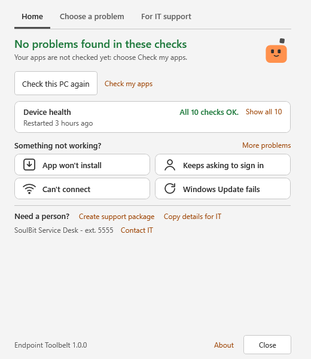
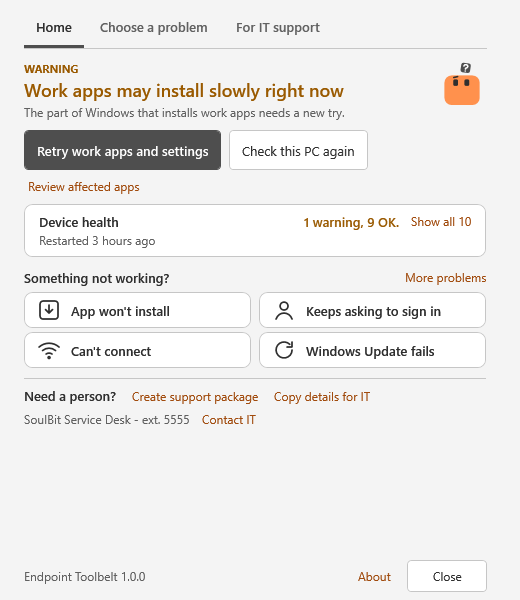
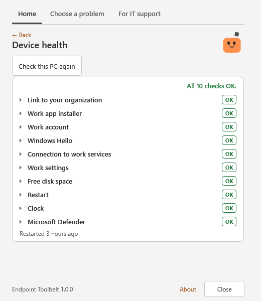
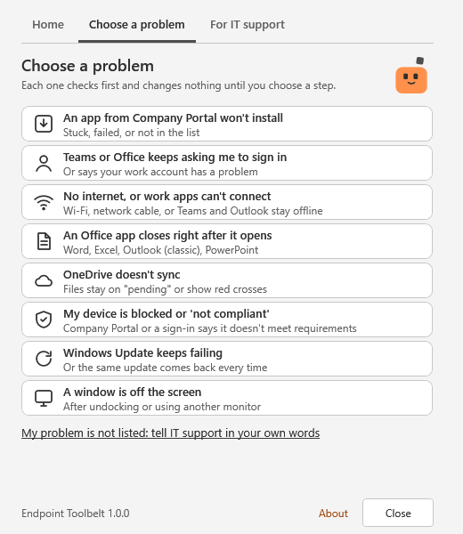
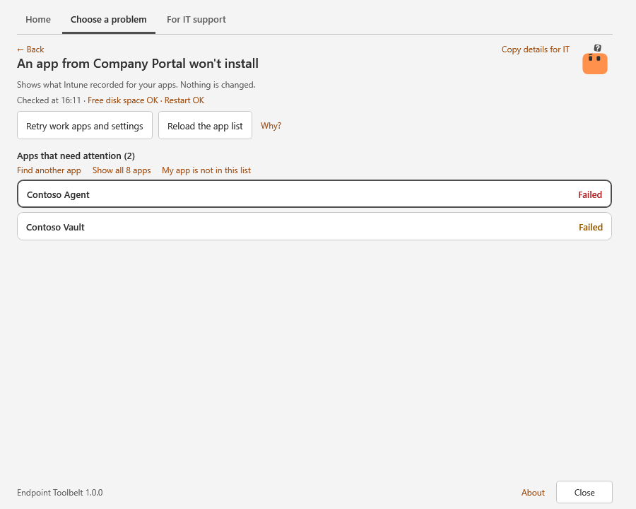
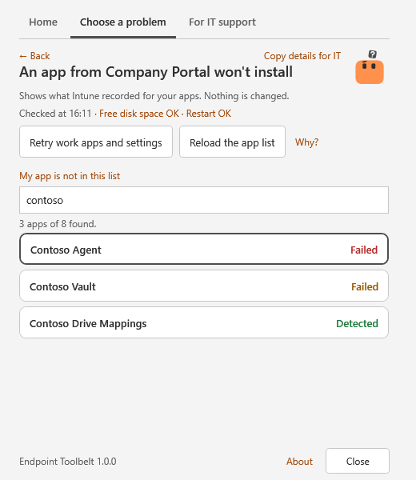
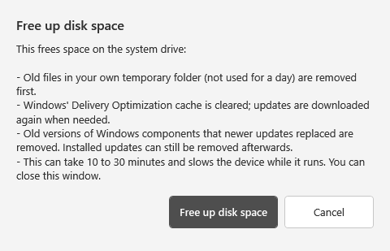
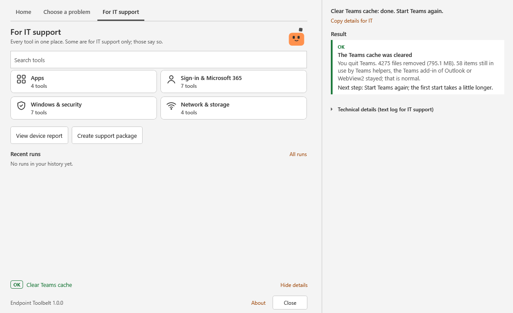
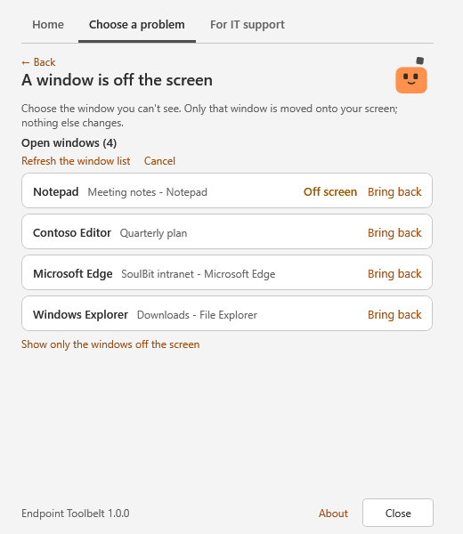
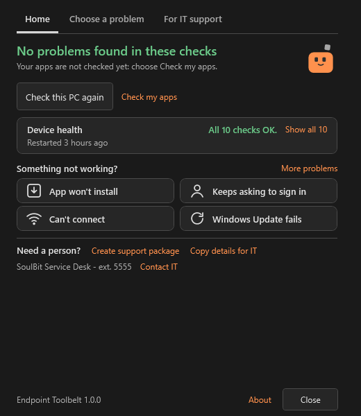

# Endpoint Toolbelt user guide

This guide is for you if you use a work PC and something does not work as it should. You do
not need any technical knowledge. It describes version 1.0.0.

## What Endpoint Toolbelt is

Endpoint Toolbelt is an app on your work PC that helps when work apps, sign-in, the network or
Windows Update give trouble. It does three things:

- It **checks** your PC and tells you in plain words whether something is wrong.
- It **fixes** common problems with a small set of safe repairs. You can run them yourself,
  without administrator rights.
- It **hands over** to your IT support when it cannot fix something: it copies the details
  they need, or makes a support package with logs.

Your organization installed the app on your PC.

## Open the app

1. Open the **Start** menu.
2. Type **Endpoint Toolbelt**.
3. Select **Endpoint Toolbelt**.

The window opens on **Home** and checks your PC right away. That takes a few seconds.

The window has three tabs at the top:

- **Home**: how your PC is doing, and the one thing to do next.
- **Choose a problem**: pick what goes wrong, and the app checks that.
- **For IT support**: every tool in one place. The few that are for IT support only say "Use it
  when IT support asks." on their line.

At the bottom of the window you find the version, **About** and **Close**. If your
organization set one, **Home** shows how to reach your IT support, as a text or a link, under
**Need a person?**.

## Check how your PC is doing

**Home** shows one clear status as its title. For example:

- "No problems found in these checks"
- "Your PC needs a restart"

When something is wrong, a word above the title says how serious it is:

- **WARNING**: something is not right yet, but you can usually keep working.
- **PROBLEM**: something does not work and needs a step.

The word is always written out, so you never have to go by colour alone.

Under the status you see:

- **One short line** that explains what was found.
- **One next step**, as a button, when there is something you can do. For example **Retry work
  apps and settings**.
- **Check this PC again**. It runs the checks again. It changes nothing on your PC. Use it after
  you fixed something yourself, for example after a restart.
- **Check my apps**. It checks your work apps and shows each one's next step. It changes
  nothing. When an app needs attention, the same link reads **Review affected apps**.

### See every check

Under **Device health** the app counts the checks, for example "All 10 checks OK." or "1
warning, 9 OK.", and says when they last ran.

Select **Show all** to open **Device health** on its own, with every check on one line each.
**Check this PC again** there runs the checks again, so you can see a fixed check turn OK, and
**Back** returns to Home. Each line has a plain name, such as
"Work app installer", "Connection to work services" or "Restart", and its state written out: OK,
WARNING or PROBLEM. Click a line, or press Enter or Space on it, to open it. It then shows
what the check means and what was found.

When a check has a fix, its line has a link that starts that fix. The link asks you to confirm
first, just like the fix's own button. When there is no fix, the line says "Contact your IT
support."

### When the app says a restart is waiting

Below the checks, Home says when your PC last started, for example "Restarted 12 days ago". After
a week or longer it adds "no restart for over a week", and while Windows waits for a restart it
adds "a restart is waiting".

This is a signal only. The app never restarts your PC. Save your work and restart when it suits
you, unless your organization tells you otherwise.

## Choose your problem

On **Home**, under **Something not working?**, you see the four most common problems. Select
**More problems** for all of them, or open the **Choose a problem** tab.

Each problem first **checks** and **changes nothing** until you choose a step. The problems are:

| Problem | What the app does |
|---|---|
| An app from Company Portal won't install | Shows your work apps and what happened with each one, with one next step per app. |
| Teams or Office keeps asking me to sign in | Checks your work account, the clock and the connection to the sign-in service. |
| No internet, or work apps can't connect | Checks whether your PC reaches the work services it needs. |
| An Office app closes right after it opens | Starts Word, Excel, Outlook (classic) or PowerPoint in safe mode. Shown only when one of them is installed. |
| OneDrive doesn't sync | Explains how to resume a paused OneDrive, and offers **Reset OneDrive**. |
| My device is blocked or 'not compliant' | Checks the settings your organization usually requires, such as BitLocker and Defender. |
| Windows Update keeps failing | Finds out why Windows does not update, and names one next step. |
| A window is off the screen | Brings back a window you cannot see. See [Bring a window back onto your screen](#bring-a-window-back-onto-your-screen). |

Each problem page shows its checks, says when everything looks fine, and lists **Try these**. A
long repair, such as Repair Windows Update, has a group of its own, **With IT support**: use it
when IT support asks.
Each tool's button says what it does, for example **Check connections** or **Reset OneDrive**.
Select **Back** to return to where you came from: Home when you chose the problem on Home, or
the list on **Choose a problem**.

### Fix an app that won't install

1. Select **An app from Company Portal won't install**.
2. The app reads what was recorded for each of your work apps. This changes nothing.
3. Under **Apps that need attention** the first three apps each have one line: their name and
   their state. The line under the title says when the apps were read, for example "Checked at
   12:07".
4. Select an app. It opens on its own: what happened, the next step and its buttons.
   **Show technical details** shows the recorded state, the IDs and the last detection run.
   Select **Back** to return to the list.
5. **Show all** opens a list of every app: the ones that need attention first, then the
   installed ones and the rest. Select **Back** to return.

The next step depends on what happened. For example:

- **Open in Company Portal**: the app is offered to you. Install it from Company Portal.
- **Retry work apps and settings**: your PC asks again for its work apps and settings, and tries
  every failed app again. Select **Why?** first if you want to know more. This affects more than
  one app.
- **Copy details for IT**: the problem needs your IT support, for example because the app
  installs but is not found afterwards.
- A restart, free disk space or another app that must come first: the app says so.

After you took a step, the app shows the app as "awaiting evidence". Wait a few minutes, then
select **Check this app again**. The app only says "App detected" when there is new proof that
the app is installed. It never takes "no error" as success.

Under the title the page says when it checked and how free disk space and a pending restart are
("Checked at 14:06 · Free disk space OK · Restart OK"; select it to see those checks). Below that
are its buttons, always in view:

- **Retry work apps and settings**: tries every failed app again. Select **Why?** to read what it
  does first.
- **Reload the app list**: reads the app list again.
- **My app is not in this list**: explains what it means when an app you need is not on your PC
  at all.

### Find an app in the list

When your PC has six or more work apps, you can search them.

1. Select **Find another app**, or press **Ctrl+F** on this page. In the list of every app and
   when no app needs attention, **Search apps** is already there.
2. Type part of the app's name.
3. The list shows the apps that match, with a line such as "2 apps of 40 found."
4. Press **Enter** to select the first app found.

The search looks through every app, also the ones that are already installed or have nothing to
do. Press **Esc** to clear the search, and **Esc** again to close it.

An app that reads **No longer assigned to you** or **No longer assigned to this device** is one
your organization no longer sends to this PC. The app may still be installed, and nothing needs to
be done. If you still need it, use **Copy details for IT** and send it to your IT support.

### Start an Office app in safe mode

1. Select **An Office app closes right after it opens**.
2. Next to your app, for example **Start Word in safe mode**, select **Start in safe mode**.
3. If the app is already open, the Toolbelt asks you to save your work and close it yourself. It
   never closes it for you.
4. The app starts without add-ins and with default settings, for this start only.
5. Try to open a document. Then answer **Could you open a document?** with **Yes**, **No** or
   **Not tried**.

Your answer helps IT support: if it works in safe mode, the cause is often an add-in or a
setting. If it also fails in safe mode, Office may need a repair.

### Check a blocked or 'not compliant' device

The app shows what your PC itself can see, such as BitLocker, Defender, the firewall and the
Windows version. Each setting that is off gets one step, for you or for IT support.

The app cannot see whether your organization says your PC meets its requirements. Company Portal
shows that. Open Company Portal and use **Check status** there.

## Run a repair

Most repairs work the same way.

### 1. Confirm

A repair that changes something asks first. The question says what will happen and what it
closes or changes. Sometimes it adds a warning, for example that your connection drops for a
moment.

- Select the button that names the repair to go ahead.
- Select **Cancel** to stop. Nothing changes.

### 2. Wait

The status below the page shows that the repair is running, with a progress bar. Some repairs
take seconds, others longer. The tool's own page tells you the typical time when it is a minute
or more. You can keep the window open while you wait. Only one repair runs at a time.

### 3. Read the result

When the repair ends, the status shows the result in one word (OK, WARNING or PROBLEM) and the
name of the repair, for example "OK Sync clock · View details". Point at it to read the whole
line. INFO means the repair ran and Intune holds the sync back for a while; Windows sends it
again by itself, so nothing is needed. The app then checks your PC again and says, for example, "Clock: now OK".

- Select **View details** for the whole result, the steps the repair took and what it changed.
  A repair that changed nothing says so in one line: "Nothing on this device was changed."
- On a problem page the app may ask **Does it work now?** Answer **Yes**, **Not yet** or **Not
  tried**. Your answer goes into Copy details for IT.
- When the result tells you to contact IT support, it also says how.

Some repairs can only run once in a while, and there is a limit on how many repairs you can run
in an hour. When you reach a limit, the app says so and nothing is changed. Try again later;
**View details** says when a repair that runs only once in a while can run again.

## Send the details to IT support

You do not have to describe technical details yourself. The app writes them for you.

### Copy details for IT

**Copy details for IT** is on **Home**, on every problem page and in **View details**. It copies
a short text for your IT support: what was checked or what ran, the outcome, the next step and a
few facts about your PC, such as when it last restarted and how it is connected to the network.
It leaves out your name and your PC's name.

1. Select **Copy details for IT**.
2. The status line says "Copied. Paste it (Ctrl+V) into your message to IT support."
3. Open your email, chat or ticket for IT support.
4. Press **Ctrl+V** to paste the text, and add in your own words what you were doing.
5. Send it the way your organization asks: **Contact IT** or the text under **Need a person?** on
   **Home**, or the way you normally reach IT support.

### Create a support package

When IT support asks for logs, create a support package.

1. Select **Create support package**. You find it on **Home** under **Need a person?**, on **My
   problem is not listed** and in **For IT support**.
2. Wait while the app collects the logs.
3. The status says "Support package saved to your Downloads folder." File Explorer opens with the
   file selected.
4. Attach the file to your message to IT support, or share it the way they ask.

The file is named after the day, year first: `Toolbelt_20261116.zip` for a package made on
November 16, 2026. A second package on the same day is `Toolbelt_20261116-1.zip`, a third
`Toolbelt_20261116-2.zip`, and so on.

The package holds logs and the state of your PC that IT support needs to find the cause. It
stays on your PC until you send it.

## Bring a window back onto your screen

An app is on the taskbar but you cannot see its window. This often happens after you undock a
laptop or unplug a monitor.

1. Select **A window is off the screen** on **Choose a problem**.
2. The app lists the windows that are off the screen, under **Off the screen**. Select **Show
   the other windows** if yours is not there. When no window is off the screen, every open
   window is listed at once.
3. Select the window you cannot see, or **Bring back** on its row. It comes back at once. A
   row that says **Can't move** belongs to an app with extra rights (an app that runs as
   administrator, or an accessibility tool such as the On-Screen Keyboard): Windows lets no app
   move it, so use that app's own button or its taskbar button.

Only that window moves. It comes back onto a screen that is connected now, at its own size when
that fits. A window that is already fully on your screen is not moved, only brought to the front.

If the list is out of date, select **Refresh the window list** above the list. Select **Cancel**
to go back without moving anything.

## When your problem is not listed

When none of the problems fits, select the link **My problem is not listed: tell IT support in
your own words** under the list on **Choose a problem**.

The page says: "Contact your IT support and tell them in your own words what goes wrong." It
shows **Contact IT** when your organization set a support link, or how to reach them otherwise.

Then it lists what IT support may ask you to do, each with its own button:

- **Copy details for IT**: copies your PC's facts and checks, to paste into your message.
- **Create support package**: collects logs, when they ask for logs.
- **Open For IT support**: opens every tool of the app. Run only the tool they name.

Contact IT support first in these cases too:

- The app says "Contact your IT support." for a check.
- A repair ended with PROBLEM and gave no step for you.
- You are not sure what a repair does. Ask first; **Cancel** never changes anything.

## Use For IT support

**For IT support** holds every tool of the app, in four groups: Apps, Sign-in & Microsoft 365,
Windows & security, and Network & storage. It also has the device report, the support package
and your recent runs.

Most tools are also offered on **Choose a problem**, for the problem they help with. A few are
for IT support only; their line ends in "Use it when IT support asks.", for example during a
phone call. A tool you open from a problem page says "Suggested for:" and that problem. To find a tool, type a word in **Search tools**, such as "clock" or
"BitLocker", and press **Enter** to open the first one found.

Each tool shows how its last run ended on the line below its name, for example "OK · today
18:38", "yesterday 19:03" or "15 Nov 19:03". Point at it to see the full date and time.

## What Endpoint Toolbelt never does

- **It never gives you administrator rights.** A small service on your PC does the work that needs
  more rights. It only runs a fixed set of repairs, and only with the confirmation each one needs.
- **It never runs anything outside its own repairs.** You cannot use it to install software or
  change other settings.
- **It never restarts your PC.** It only tells you when a restart is waiting.
- **It never closes an app without asking.** When a repair needs an app closed, it names the app
  and waits for your answer.
- **It never changes your organization's policies.** When a policy holds something back, such as
  a Windows update, the app says so and names who can change it.
- **It never sends anything by itself.** It has no server of its own and sends nothing in the
  background. IT support only sees what you send them.

## Keyboard shortcuts

You can use the whole app with the keyboard. Press **Tab** to move between buttons and links, and
**Enter** or **Space** to select one.

| Keys | What they do |
|---|---|
| Alt+M | Open Home |
| Alt+P | Open Choose a problem |
| Alt+F | Open For IT support |
| Alt+E | Check this PC again |
| Alt+A | Check my apps (Review affected apps when an app needs attention) |
| Alt+I | Check this app again |
| Alt+R | Retry work apps and settings, on the app page |
| Alt+B, Alt+Left or Backspace | Back |
| Alt+D | View details |
| Alt+T | Copy details for IT, in View details |
| Alt+K | Create support package, in For IT support |
| Alt+H, Ctrl+F or Ctrl+K | Search tools, in For IT support |
| Ctrl+F | Search apps, on the app page when the search is shown |
| Enter | In a search box: open or select the first result |
| Esc | Clear the search box |
| Alt+C | Close the app |

Underlined letters on buttons show more Alt keys. Hold **Alt** to see them.

## Change how the app looks

The app follows your Windows settings:

- **Dark mode**: when Windows uses the dark app mode, the app is dark too.
- **High contrast**: the app uses your high contrast colours. The small figure in the top right
  is hidden then.
- **Animations**: when Windows animation effects are off, nothing in the app moves. A click on
  the mascot then changes its pose for a moment, without movement.

The small figure in the top right of every page only decorates. It shows the mood of the page,
but all information is always in the text.

## Frequently asked questions

**Is it safe to run a repair?**
Yes. Every repair that changes something asks first and says what it changes. The checks never
change anything. When in doubt, select **Cancel** and ask your IT support.

**Home says "The Endpoint Toolbelt service is not available". What now?**
The checks that need the service, the app list and the repairs cannot run until it is back.
Restart your PC. If it stays like this, select **Copy details for IT** and send it to your IT
support.

**I ran Retry work apps and settings, but my app is still not there.**
That is normal at first. The status says "Retry requested": your PC asked for its apps again, and
installing happens in the background. Wait a few minutes, then select **Check this app again**.

**Will a repair delete my files?**
No. The repairs remove caches and temporary files that Windows or an app creates again by itself.
Your documents stay where they are. **Reset OneDrive** makes OneDrive sync again from the start;
your files stay where they are.

**Can I use the app without a network connection?**
Partly. The checks and some tools work offline. Repairs that need Microsoft services, such as a
sync with your organization or Windows Update, need a connection.

**Why is a tool missing, or does it say "Not available"?**
Your organization can switch single tools off. A tool for an app that is not installed, such as
**Start Word in safe mode** without Word, says "Not available" with the reason.

**In which language is the app?**
English only.

**Where do I find an earlier result?**
Open **For IT support**. **Recent runs** lists your newest runs; select one to open its log.
